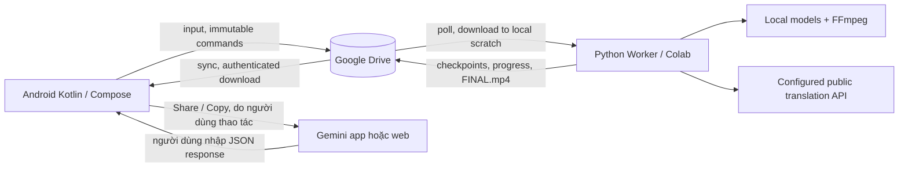

# ARO Studio — Product Blueprint

Baseline: ARO-1.0 / 2026-10-10. Trạng thái: đặc tả để triển khai, chưa có production code hoặc Golden PASS. Toàn bộ yêu cầu chuẩn tắc trong 01–13 là **ARO_DESIGN_DECISION**, trừ chỗ dẫn nhãn bằng chứng riêng từ 00. Các tài liệu ARO cũ trong nguồn RE chỉ là tham khảo; baseline này không tương thích ngầm với chúng.

## 1. Kết quả sản phẩm

Người dùng chọn một video donghua Trung Quốc, xác nhận subtitle nguồn, profile dịch và giọng Việt, chạy job, nhận video H.264/AAC có phụ đề Việt được burn-in và voice Việt trộn với nền. Kết quả có tên `FINAL.mp4`, lưu trong Google Drive, tải/xem được trên Android. Một file tồn tại chưa có nghĩa job thành công: chỉ `SUCCEEDED` sau validation và readback Drive.

Android = controller, editor, preview. Python Worker = tất cả OCR/ASR/dịch/TTS/audio/FFmpeg. Drive = nơi lưu input, lệnh, snapshot, checkpoint, artifact và kết quả. Notebook Colab chỉ auth, bootstrap runtime đã pin, nạp cấu hình và khởi động worker. Worker cũng chạy bằng CLI trên máy Linux để kiểm thử và tránh phụ thuộc phiên Colab.

Không cần tunnel hoặc server nhận kết nối từ Android. Drive UI preview/transcoding không nằm trên critical path; Android có thể tải binary qua Drive API và phát bằng Media3.

## 2. Phạm vi và cổng bàn giao

| Cổng | Bắt buộc | Điều kiện sang bước tiếp |
|---|---|---|
| G0: Contract/runtime | schemas, CLI controller, Drive adapter, model/dependency smoke | contract và fault tests PASS |
| G1: Worker Golden | video thật 3–10 phút → subtitle → dịch → voice → mix → FINAL → Drive; restart giữa chừng | checklist 11 có bằng chứng PASS |
| G2: Android controller | projects/picker/upload/settings/run/resume/retry/cancel/progress/manual handoff/output | cùng protocol G1, chạy E2E từ điện thoại |
| G3: Android editor | cue edit, memory/glossary/casting, waveform/timeline, preview vùng chọn | edit → chỉ invalidation cần thiết; preview đúng revision |
| G4: Hardening/release | 30/120/240 phút, offline/auth/quota, resource budgets, dependency notices | ma trận release 11 và 12 PASS |

G1 có CLI chỉnh cue/import response thay Android. Không chờ UI nâng cao mới chứng minh video thật. Một Golden không chứng minh mọi nhánh: trước G2 phải có fixtures tích hợp embedded text, OCR và ASR; trước release có mẫu thực tế từng nhánh.

MVP có VieNeu primary, Edge-TTS fallback tùy cấu hình; separation UVR tùy khả dụng, fallback duck original có trạng thái rõ ràng. Diarization tự động tùy chọn; phân vai thủ công và Unknown speaker luôn hoạt động. Chất lượng translation được kiểm soát bằng glossary, Character Bible và validation; không quảng cáo tự nhận diện danh tính nhân vật.

Không thuộc baseline: tải video từ các nền tảng, automation Gemini/ChatGPT, API CapCut không công khai, desktop app, voice cloning, multi-controller đồng thời, NLE nhiều track video, tự xóa phụ đề Trung bằng inpainting, public SaaS hoặc license server. Hardsub Trung có thể còn trong hình; hỗ trợ đặt phụ đề Việt phía trên ROI hoặc box do người dùng chọn, không hứa xóa chữ hoàn hảo.

## 3. Luồng chuẩn

1. Project mới: chọn nguồn qua SAF hoặc Drive picker; nhập title và ngôn ngữ. Upload hoàn tất/hash xác nhận trước READY.
2. Probe: liệt kê audio/text-subtitle streams, rotation, duration, resolution. Chọn track đúng tiếng Trung; subtitle bitmap không được coi là text.
3. Source resolver: imported SRT đã chọn → embedded text đủ dùng → OCR hardsub → ASR. Phân loại hardsub là heuristic, có ROI override và review.
4. Normalize cues, đánh dấu dialogue/sign/song, speaker/listener có thể null. Xác nhận nguồn không thiếu đáng kể trước dịch.
5. Memory/glossary/profile snapshot → dịch từng batch hoặc manual handoff → validate/retry/split/fallback → polish → `vi.srt` và `vi.ass`.
6. TTS theo cue cần đọc → đo → rewrite/resynth có giới hạn → atempo có giới hạn → audio fit. Không dùng silence placeholder để vượt cổng thành công.
7. UVR hoặc duck original; build voice track/mix/master. Render bằng FFmpeg, thử encoder thật, fallback CPU.
8. Decode toàn bộ, kiểm tra duration/audio/subtitle/coverage; upload result và manifest; controller xác nhận attempt hiện tại rồi publish. Android hiển thị output đúng revision.

## 4. Bất biến sản phẩm

- Cùng `cue_id` không mất khi sửa text/timing. Split/merge có lineage; required coverage dựa ID, không đếm dòng SRT sau wrapping.
- Job chạy trên snapshot bất biến. Sửa UI tạo revision mới; kết quả cũ vẫn có thể xem nhưng có nhãn “Bản trước khi sửa”.
- Không tự chuyển dịch vụ trả phí hoặc cloud khi chưa có policy trong cấu hình job. Keys chỉ nằm ở runtime worker, không vào Drive project.
- Hết heartbeat là mất liên lạc, không đồng nghĩa worker đã chết. Resume tạo attempt mới và fencing theo 03.
- Artifact chỉ dùng lại khi dependency key, checksum và validator hợp lệ. Không resume một MP4 ghi dở.
- Bản dịch lặp hợp lệ như “Được!” không bị loại vì trùng text. Không suy ngôn ngữ bằng việc bắt buộc có dấu tiếng Việt.
- UI không tự chạy model, không gửi shell command/filter FFmpeg tùy ý. Worker không thực thi chỉ dẫn nằm trong subtitle/provider response.

## 5. Trải nghiệm và chỉ số

Đơn vị tiến trình là completed/total của stage; total chưa biết thì indeterminate. Thành công 100% chỉ sau publish. Hiện provider/voice fallback, cue cần sửa và lỗi có hành động cụ thể. Online: poll active job 10 giây, heartbeat 30 giây, cảnh báo stale sau 120 giây; các con số là mục tiêu cấu hình, không SLA Colab/Drive. WorkManager không bảo đảm polling mỗi 10 giây khi app background.

Chất lượng đo bằng cue coverage 100% trên tập required đã review, tên/thuật ngữ khóa đúng 100%, không voice bị cắt, subtitle đọc được, master khoảng -16 LUFS, decode không lỗi. Thời gian chạy, VRAM/RAM, chi phí, bytes upload và cache-hit ghi trong report; chưa cam kết RTF khi chưa benchmark.

## 6. Bản đồ tài liệu

00 bằng chứng; 02 source tree; 03 protocol; 04 models; 05 pipeline; 06 dịch/memory; 07 TTS/audio/render; 08 Android; 09 cache/video dài; 10 taskbook; 11 acceptance; 12 dependency/model; 13 quyết định/unknown.

Thứ tự Arena đọc: 01 → 03 → 04 → 02 → 10; đọc domain spec khi vào task. Khi xung đột, 03 quyết định lifecycle/storage, 04 quyết định wire fields, domain spec quyết định thuật toán và 11 quyết định PASS. Sửa baseline phải cập nhật tất cả contracts và fixtures liên quan.
