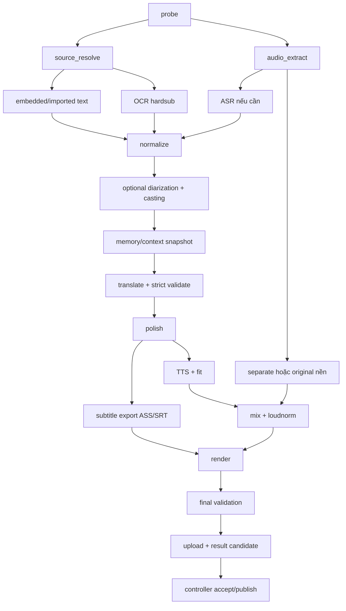

# Worker Pipeline Specification

**ARO_DESIGN_DECISION**. Worker là package `aro_worker`, CLI entry `aro`. Module không import notebook hoặc UI. Quy trình sync CPU/model chạy trong child process, scheduler/event loop và heartbeat ở process cha. Model load lazy, một GPU stage tại một thời điểm; cancellation phải giết được process group.

## 1. DAG và contracts



| stage_id | Input → output committed | Validator / resume granularity |
|---|---|---|
| probe | source → probe.json | dimensions/timebase/streams; source hash |
| source_resolve | probe + policy/import ref → selection.json | selected stream exists, method explicit |
| audio_extract | source + audio stream → asr16.wav + mix48.wav | sample count/profile and offset; whole file |
| source_extract | selection + video/audio → raw_cues pages | imported/embedded/OCR/ASR branch; chunks |
| normalize | raw cues → source dataset + source.srt | intervals/coverage/source review; dataset |
| diarize | asr audio + source cues → speaker proposals | optional, can skip; chunk/stitch |
| memory | dataset + approved memory/cast → context snapshot | no unresolved locked conflicts |
| translate | dataset/context → validated batch items | required IDs + content checks; batch |
| polish | translation → final cue dataset | faithfulness/locks/readability; cue/batch |
| subtitle_export | final cues + canvas/style → vi.srt + vi.ass | count/lineage/ASS geometry; document |
| tts_fit | final cues + cast → TTS manifest + fits | required voices/timing; cue |
| background | mix48.wav + mode → background48.wav | stems/offset/leakage review; windows |
| mix | fitted TTS + background → voice.wav/master_audio.wav | sample coverage/peak/loudness; full or windows |
| render | source + master + ASS → local candidate.mp4 | encoder success, no partial accepted |
| final_validate | candidate + manifests → validation.json | 11 checks; whole output |
| publish_candidate | valid output → Drive blobs/result.json | hashes/readback; per blob |

Parallel scheduling chỉ khi dependencies độc lập, ví dụ background và translation. MVP không stream ASR→Translate trước khi normalize/source review hoàn tất; phase hardening có thể xử lý stable pages nhưng không đổi contract đã publish.

## 2. Stage interface và runner

```python
class Stage(Protocol):
    stage_id: str
    version: str
    def dependencies(self, job: JobRequest) -> list[str]: ...
    def input_key(self, inputs: StageInputs, config: PipelineConfig) -> str: ...
    def run(self, ctx: StageContext, inputs: StageInputs) -> StageOutput: ...
    def validate(self, out: StageOutput) -> ValidationReport: ...

# StageContext: attempt, scratch, artifact_store, cache, cancellation,
# progress callback, public provider profiles, secret resolver, resource budget.
```

Runner: verify assignment → resolve dependencies → verify cache manifest + blob hashes → emit RUNNING → execute process → validate outputs → upload durable artifacts → commit checkpoint → emit SUCCEEDED. Exception maps AroError; unknown exception INTERNAL with sanitized diagnostics. Stage MUST NOT mark succeeded before durable commit. Heartbeat không bị chặn bởi model inference hoặc FFmpeg. CTRL-C tương đương graceful cancel local, SIGKILL được khôi phục bằng committed checkpoints.

Progress: real work units (frames/chunks/cues/bytes/render_ms); không tăng completed khi thử lại cùng unit. ETA chỉ khi đủ samples, có nhãn ước tính. FFmpeg `out_time_us` là microseconds, không nhầm với tên field `out_time_ms` của một số build; ưu tiên out_time_us hoặc parse out_time HH:MM:SS. stderr drain song song để không deadlock.

## 3. Probe và media timeline

Run `ffprobe -v error -show_format -show_streams -of json <input>` bằng argv không shell. Chọn video stream không attached_pic. Đọc stream absolute index, language và disposition; không mặc định `0:s:0` là subtitle Trung đúng. Duration hợp lệ, finite, >0; khi container thiếu duration đọc packet timestamps có giới hạn hoặc block review. Rotation và SAR tính display canvas; normalize PTS về global timeline 0, giữ audio start offset khi resample. Fixture phải có nonzero start time, VFR, portrait rotated và mono/stereo.

ASR audio PCM s16le/16k/mono; mixing PCM float32/48k/stereo. ASR resampling không làm mất timestamp gốc. Input không audio vẫn xử lý subtitle/voice nếu có source text; tạo nền silence rõ cấu hình. Không subtitle và không audio → NO_USABLE_SUBTITLE. HDR phát hiện qua transfer metadata; baseline không tone-map âm thầm, yêu cầu SDR source hoặc config hỗ trợ đã test.

## 4. Resolver subtitle

Priority: user imported source SRT → user-chosen embedded text → auto suitable text → hardsub OCR → ASR. Text codec whitelist subrip/ass/ssa/mov_text/webvtt. PGS/DVD bitmap không convert trực tiếp ra SRT; baseline chuyển OCR khung hình hardsub nếu hiện trong ảnh, nếu không ASR hoặc user cung cấp text. Trường hợp bitmap-only cần mở rộng decoder bitmap riêng, không giả hardsub có sẵn.

Extract stream bằng absolute index, convert text timing, loại ASS formatting từ text nhưng giữ raw ref. Track forced-only hoặc subtitle rất thưa được cảnh báo; các bài hát/sign không nhất thiết cover thoại. Chất lượng nguồn là review gate, không đơn giản “có một cue là dùng”. Preview source sample đầu/giữa/cuối, đối chiếu speech regions để tìm gaps >3s không subtitle (warning, VAD không ground truth). User chọn track/method hoặc xác nhận nguồn.

Hardsub detector sample 12 timestamps đều toàn video, OCR bottom ROI và kiểm tra text ổn định qua ≥2 frame gần nhau. Có ≥3 sample hit → đề xuất OCR. Không đủ → đề xuất ASR, không khẳng định không có hardsub. User có thể chọn OCR ROI khác. Selection.json ghi scores, selected method, reviewer/override.

## 5. OCR clean-room

RapidOCR adapter dùng model manifest đã kiểm chứng, ưu tiên PP-OCRv6 theo nguồn RE, fallback public supported model có provenance và user config. Không lấy weights từ bundle đối thủ. Full extraction 4 fps, ROI bottom 25% mặc định, width≤1280 sau crop; video dài vẫn 4 fps, không hạ xuống 0.25 fps làm mất thoại ngắn. Cache frame observations theo source/ROI/timestamp/preprocess/model.

Frame decode stream bounded; detector/recognizer result bbox+text+confidence. NFC normalize và whitespace; không loại toàn bộ ASCII ngắn vì số/tên/biển hiệu hợp lệ. Filter watermark dựa ROI, persistence xuyên nhiều scene và review; lưu rejected observations để inspect. pHash chỉ skip inference khi gần giống, vẫn ghi observation/time để kéo dài cue; heartbeat OCR ít nhất mỗi 500ms dù hash hit để tránh mất thay đổi chữ nhỏ.

Group boxes theo baseline/line order; group temporal text bằng normalized edit similarity≥0.9 và bbox overlap≥0.5, gap≤250ms. Hai text khác nghĩa không merge chỉ vì dùng cùng ký tự. Cue boundary ước lượng giữa last-old/first-new, refine binary search tới 50ms với OCR frame bổ sung. Empty observations đóng cue; không nối cùng text qua gap >250ms. Confidence <800/1000, cue chỉ một observation hoặc boundary mơ hồ → source review. Có chunk 60s + overlap 1s, core ownership như ASR. Cache quan sát cho phép refine không OCR lại toàn phim.

## 6. ASR + Silero VAD

faster-whisper/CTranslate2, Chinese cố định nếu user chọn; word_timestamps bật. CUDA compute int8_float16 khi smoke PASS, CPU int8 fallback. GPU OOM: release model, giảm batch, retry một lần; CUDA incompatibility thử CPU một lần và ghi effective runtime vào key. CPU/model chậm không giả là fail ở timeout quá ngắn; watchdog có deadline theo duration và progress.

Silero VAD trên audio 16k: threshold khởi đầu 0.5, min speech 250ms, min silence 350ms, padding 200ms. Các giá trị là config ARO cần calibrate. VAD crash có thể chạy không VAD với warning, không xóa thoại. Chia target 30s, max45s tại khoảng lặng gần target; decode overlap 1s, core intervals liên tiếp không gap. Không concat chỉ speech rồi quên offset.

Chunk raw words convert về global ms. Word midpoint nằm trong core của chunk nào thì chunk đó sở hữu. Vùng boundary dùng alignment text với timestamp proximity≤500ms, confidence chọn giữa candidates; repeated words liên tiếp phải được giữ khi nằm ở thời gian khác. Mâu thuẫn không resolve → review. Segmentation tại punctuation/pause≥250ms, target≤7s; không tách giữa word và không bịa thời điểm nếu model không có word timing. Cache raw JSON từng chunk trước stitching.

## 7. Normalize / diarization / memory

Không drop cue rỗng âm thầm: mark invalid để sửa hoặc exclusion có xác nhận. Duplicate source cue chỉ merge khi cùng provenance và overlap gần hoàn toàn. Numbering SRT regenerate; giữ mapping raw events→cue_id.

Diarization optional pyannote adapter trong environment riêng, model licenses/token theo 12. Gán speaker khi overlap speech turn/cue≥0.6; thấp hơn hoặc nhiều speaker → unknown/overlap issue. Không suy character identity hoặc mối quan hệ từ pitch. Voice-style/gender suggestion chỉ optional catalogue recommendation, không cổng bắt buộc. Manual cast hoạt động cả khi diarization absent.

Memory snapshot phải committed trước translation. Profile/glossary/cast edits tạo revision mới. Uncertain proposals hiển thị nhưng không override confirmed rules. Chi tiết ở 06.

## 8. Colab lifecycle

Notebook ≤6 cell: runtime capability check → auth Drive API (mount chỉ optional để browse) → install immutable worker wheel và lock → model manifest verification/download → configure workspace/controller session và secret resolver → `aro worker run`. Auth interactive là một lần trên runtime, không nhúng refresh token vào notebook/Drive. Worker package có `aro doctor --json`, `aro worker run`, `aro controller ...` và `aro validate result`.

Colab runtime mất thì model/scratch có thể mất; checkpoints cần thiết đã upload. Notebook restart tạo session mới; controller cấp attempt mới. Không cam kết worker chạy khi notebook đã bị Colab ngắt. `aro doctor` hiển thị Python/CUDA/cuDNN/FFmpeg filters/model availability/disk/quota access trước nhận job.

## 9. Tests có ý nghĩa

Unit cho resolver, timestamps, dedup, boundaries; media integration dùng FFmpeg thật với text streams/bitmap/rotation/VFR/missing audio. Models có contract stubs để fault tests nhanh, nhưng G1 dùng models/providers thật. Inject SIGKILL sau raw chunk commit, network loss khi heartbeat, cancel giữa FFmpeg và malformed provider result. Expected counters cho thấy checkpoint hợp lệ được reuse; validators không cho stale input đi tiếp.
